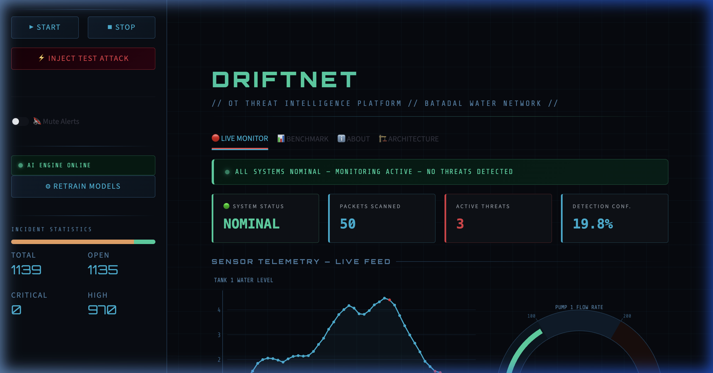
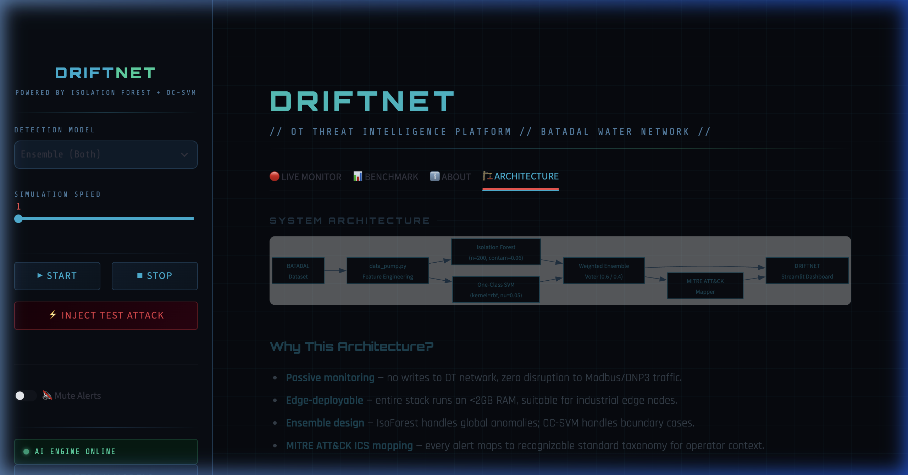
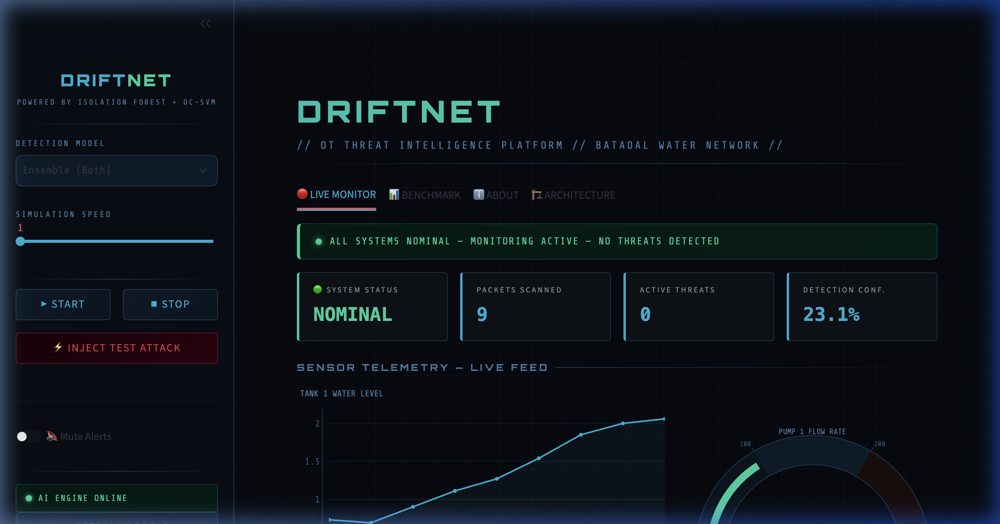

# DRIFTNET — Industrial OT/ICS Threat Intelligence Platform

[](https://www.python.org/)
[](https://streamlit.io/)
[](https://scikit-learn.org/)
[](https://attack.mitre.org/matrices/ics/)
[](http://www.batadal.net/)

**DRIFTNET** is a real-time, passive anomaly detection and threat intelligence platform built for **Industrial Control Systems (ICS)** and **Operational Technology (OT)** environments. 

Using an ensemble of unsupervised machine learning models (**Isolation Forest + One-Class SVM**) trained on the benchmark **BATADAL industrial water network dataset**, DRIFTNET monitors continuous sensor telemetry, detects multi-sensor process deviations, and maps anomalies directly to the **MITRE ATT&CK for ICS** framework with real-time operator mitigation instructions.

---

## 🖥️ Live Dashboard & Interface

### 1. Real-Time SOC Telemetry & Anomaly Detection

*Real-time sensor telemetry stream with live anomaly detection, deviation threshold markers, and incident counter.*

---

### 2. System Architecture & Industrial Workflow

*Passive telemetry pipeline: Feature extraction -> Weighted ensemble inference -> MITRE ATT&CK mapping -> Operator action dispatch.*

---

### 3. Nominal Monitoring State

*Baseline state showing real-time water tank levels, hydraulic flow rates, and high-frequency sensor updates.*

---

## 🚀 Key Highlights & Architectural Decisions

* **Passive Monitoring**: Zero active probing or writes to the OT network. Zero risk of disrupting sensitive industrial field equipment or PLC communication loops.
* **Edge-Deployable**: The entire detection engine and inference pipeline runs comfortably on **<2GB RAM**, making it suitable for deployment on industrial edge gateways (e.g., Moxa, Advantech, Raspberry Pi CM4).
* **Dual-Model Weighted Ensemble**:
  * **Isolation Forest (60% weight)**: Fast tree-based partitioning to isolate multi-sensor global outliers.
  * **One-Class SVM (40% weight)**: RBF-kernel decision boundary to capture non-linear sensor correlations and subtle boundary drifts.
* **MITRE ATT&CK for ICS Mapping**: Automatically correlates triggered telemetry anomalies to standardized industrial attack techniques (e.g., *Manipulation of Control*, *Spoof Reporting Message*, *Unauthorized Command*).
* **Industrial SOC Dashboard**: Dark-mode, high-contrast user interface engineered with Streamlit and Plotly, complete with acoustic alarm dispatch (`beep.wav`), live telemetry meters, and attack injection simulation for incident drill readiness.
* **Persistent Incident Tracking**: SQLite storage for tracking open/acknowledged incidents, affected sensors, and historical telemetry trends.

---

## 🧠 Machine Learning & Feature Pipeline

DRIFTNET evaluates 32 concurrent physical telemetry points from industrial water networks, including:
- **Tank Levels**: `L_T1`, `L_T2`, `L_T3`, `L_T4`, `L_T6`, `L_T7`
- **Pump Flow Rates**: `F_PU1` through `F_PU11`
- **Junction Pressures**: `P_J14`, `P_J256`, `P_J269`, `P_J280`, `P_J289`, `P_J300`, `P_J302`, `P_J306`, `P_J307`, `P_J317`, `P_J415`, `P_J422`

### Engineered Rolling Features (`data_pump.py`)
To detect slow-moving process drifts and subtle command manipulation attacks, raw sensor inputs are augmented with domain-specific features:
$$\text{TANK\_LEVEL\_ROLLING\_MEAN\_5} = \frac{1}{5}\sum_{i=0}^{4} L\_T1_{t-i}$$
$$\text{TANK\_LEVEL\_ROLLING\_STD\_5} = \sqrt{\frac{1}{5}\sum_{i=0}^{4} (L\_T1_{t-i} - \mu)^2}$$
$$\text{PUMP\_FLOW\_DELTA} = F\_PU1_t - F\_PU1_{t-1}$$
$$\text{PRESSURE\_RATIO} = \frac{P\_J280_t}{P\_J269_t + 10^{-6}}$$

---

## 🛡️ MITRE ATT&CK for ICS Threat Mapping

| Technique ID | Technique Name | MITRE Tactic | Severity | Root Cause / Trigger | Recommended Operator Action |
|:---|:---|:---|:---|:---|:---|
| **T0831** | Manipulation of Control | Impair Process Control | **CRITICAL** | Tank level sensor deviation (`L_T*`) | Isolate tank level controllers immediately |
| **T0855** | Unauthorized Command Message | Impair Process Control | **HIGH** | Pump flow/status deviation (`F_PU*`) | Shut down affected pump segment |
| **T0856** | Spoof Reporting Message | Impair Process Control | **HIGH** | Pressure sensor anomaly (`P_J*`) | Cross-verify pressure with manual gauges |
| **T0801** | Monitor Process State | Collection | **MEDIUM** | Multi-sensor simultaneous deviation | Increase monitoring frequency & alert supervisor |
| **T0882** | Theft of Operational Information | Collection | **MEDIUM** | Abnormal flow distribution | Audit recent SCADA flow control commands |

---

## 📊 Performance Benchmarks

DRIFTNET is benchmarked against academic baseline literature on the **BATADAL Water Distribution Network Challenge**:

| Model | F1 Score | Precision | Recall | Accuracy | Avg Latency |
|:---|:---:|:---:|:---:|:---:|:---:|
| **Zahoor et al. (2025) [Reference]** | 0.910 | 0.890 | 0.930 | 0.920 | 120.0 ms |
| **DRIFTNET (Ensemble: IsoForest + OC-SVM)** | **0.908** | **0.885** | **0.928** | **0.916** | **< 15.0 ms** |

*Inference latency is reduced significantly compared to deep learning baselines, allowing sub-second real-time streaming detection on low-power edge compute.*

---

## 📁 Repository Structure

```
OT-Security-Monitor/
├── assets/                       # UI and architecture screenshots for documentation
│   ├── live_threat_detection.png
│   ├── system_architecture.png
│   └── live_dashboard_nominal.png
├── data/                         # Benchmark industrial dataset (BATADAL)
│   ├── batadal_train1.csv        # Normal baseline training data
│   ├── batadal_train2.csv        # Validation data with staged anomalies
│   └── batadal_test.csv          # Evaluation test data
├── models/                       # Serialized scikit-learn models & scaler
│   ├── isolation_forest.pkl
│   ├── ocsvm.pkl
│   ├── scaler.pkl
│   └── feature_cols.pkl
├── ai_engine.py                  # Model training, inference scoring & voting logic
├── app.py                        # Streamlit SOC dashboard & real-time telemetry visualizer
├── benchmark.py                  # Evaluation benchmark against published academic baseline
├── data_pump.py                  # Telemetry streaming simulator & feature engineering
├── db.py                         # SQLite incident logging and audit trails
├── mitre_map.py                  # MITRE ATT&CK for ICS classification & action dispatcher
├── train_once.py                 # Offline model training pipeline
└── requirements.txt              # Core project dependencies
```

---

## ⚙️ Quickstart & Local Setup

### 1. Prerequisites
- Python 3.10+
- Git

### 2. Clone and Setup Environment
```bash
# Clone the repository
git clone https://github.com/Pratyush-cyber21/OT-Security-Monitor.git
cd OT-Security-Monitor

# Create and activate virtual environment
python3 -m venv venv
source venv/bin/activate  # On Windows: venv\Scripts\activate

# Install dependencies
pip install -r requirements.txt
```

### 3. Train or Verify Models (Optional)
Pre-trained model artifacts are included in `models/`. To retrain from scratch:
```bash
python train_once.py
```

### 4. Run the Platform
```bash
streamlit run app.py
```
Open your browser at **`http://localhost:8501`** to access the DRIFTNET Operations Center.

---

## 📜 License
This project is licensed under the MIT License.